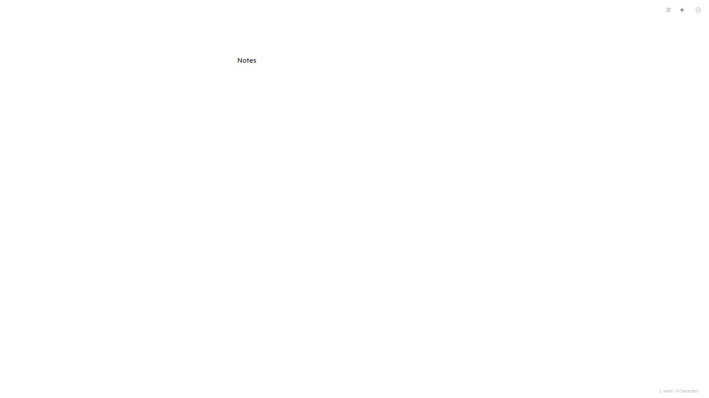

# Papyrus

A distraction-free writing app, as a desktop window **or a browser tab**. Every time
you open it (or hit `Ctrl+N`), you get one blank page and a cursor. Nothing to name,
nothing to file. The moment you stop typing, the note is saved to disk as a plain
`.txt` file, so your words outlive the app itself.



## Install

Download from the [Releases page](../../releases):

- **`Papyrus-Setup-<version>.exe`** — one-click installer. It installs just for your
  user account (no admin needed), adds Desktop and Start Menu shortcuts, and can be
  uninstalled from Windows Settings > Apps.
- **`Papyrus-Portable-<version>.exe`** — no installation; run it anywhere.

> Windows SmartScreen may show "Windows protected your PC" on first run because the
> app isn't code-signed. Click **More info → Run anyway**.

## Build from source

Requires [Node.js](https://nodejs.org) 18+.

```sh
npm install     # install dependencies
npm start       # run the app
npm run dist    # build the installer + portable exe into dist/
```

## How saving works

- **Filename:** `YYYY-MM-DD HHMMSS - <first line of the note>.txt`
- **Where:** a folder you choose (Settings > Notes folder). Search still finds notes
  in every folder you have ever used, including `Documents\Blank Slate` from the
  original version.
- **Safety net:** besides the save 600ms after you pause typing, anything you have
  typed is flushed to disk at least every 10 seconds, and again when the window
  closes. A completely empty page is never saved as a file; emptying an existing
  note leaves the last saved content on disk rather than writing a blank file.

## Pasting pictures

Paste a screenshot (`Ctrl+V`) or drop an image file onto the page and it appears
right where the cursor is, drawn over its own line in the note. The picture is
saved as a real file in an `images` folder next to your notes; the note itself
only stores a plain-text reference (``) plus the blank
lines the picture sits on, so every note remains an ordinary `.txt` any app can
read. Editing around a picture works like a document: `↓`/`↑` step over its
lines, and `↑` from below lands on the reference line above it where you can
start typing (your words appear above the picture). Clicking a picture selects
it — the reference text stays hidden and white corner squares appear; drag one
to resize (proportions stay locked, like Google Docs), and the new size is
stored in the reference itself so the note reflows around it. With a picture
selected, `Backspace`/`Delete` removes it in one stroke, and so does
`Backspace` on the line right below it or `Delete` on the line right above it.
You can also delete the reference and its blank lines by hand.

## Use it in a browser tab

Settings > **Use in a browser** copies an address like `http://localhost:7331`
and opens it in your default browser. The tab talks to the same local server the
desktop app runs (127.0.0.1 only, never exposed to your network), reads the same
notes folder, and shares the same theme and font settings. Close the desktop
window and the app keeps running in the tray so the tab keeps working; quit from
the tray icon.

For one-click access, the **Papyrus in Browser** desktop shortcut starts the app
quietly in the background if it is not already running, then opens your browser tab.

## Keyboard

| Key | Does |
| --- | --- |
| `Ctrl+N` | New blank page |
| `Ctrl+P` | Search all notes |
| `Ctrl+,` | Settings |
| `Ctrl+S` | Save now |
| `Esc` | Close search / settings |

## Fonts & Spacing

Settings > **Font** shows a grid of fonts (each chip previews itself), a field for
any font installed on your system, an **Import…** button that loads a `.ttf`,
`.otf`, or `.woff` file, and a **Line spacing** control (1.0 to 3.0) that you can
step in tenths or type to two decimals. Imported fonts live in
`%APPDATA%\Papyrus\Fonts` and are
shared with browser tabs. Font size can be stepped or typed between 10 and 48
pixels.

## Data

Everything is stored locally as plain text. No accounts, no network.

- `%APPDATA%\Papyrus\settings.json` (theme, font, line spacing, notes folder)
- `%APPDATA%\Papyrus\switcher.json` (search ranking, pins, startup preference)
- Your notes folder, wherever you pointed it — including its `images` subfolder,
  where pasted screenshots live

## Tech Stack

- [Electron](https://www.electronjs.org/)
- HTML, CSS and vanilla JavaScript
- Packaged with [electron-builder](https://www.electron.build/) — NSIS installer and portable exe

## License

[MIT](LICENSE)
